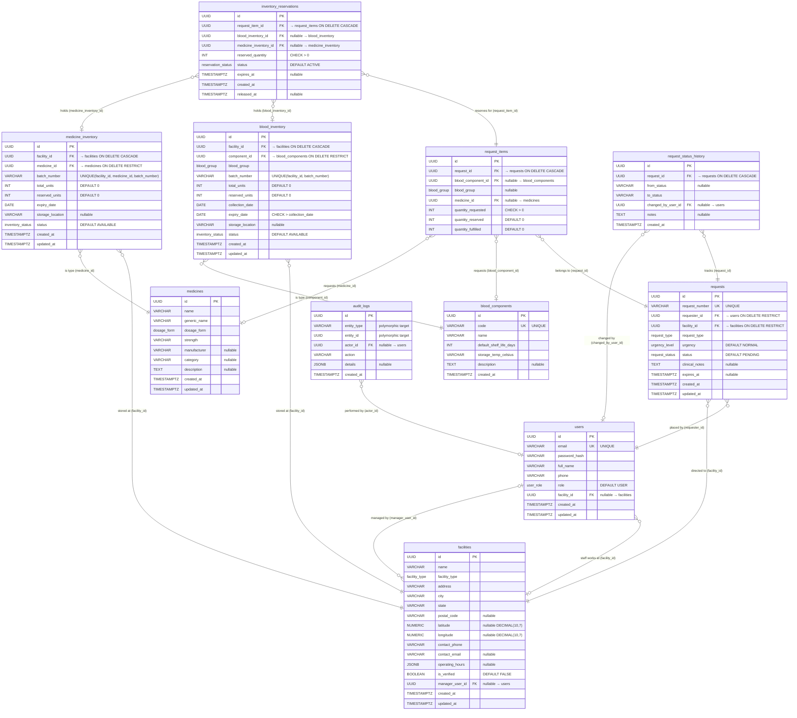

# LifeLink — Entity Relationship Diagram

> **Source of truth:** `server/prisma/schema.prisma` and `database/schema.sql`
>
> **Database:** PostgreSQL 14+ · **ORM:** Prisma · **Schema Normal Form:** 3NF

## ER Diagram (Mermaid)

## Entity Summary

| # | Table (PostgreSQL) | Prisma Model | Columns | PK | FKs | Description |
|---|---|---|---|---|---|---|
| 1 | `users` | `User` | 8 | `id` | `facility_id` → facilities | Registered users (donors, staff, admins) |
| 2 | `facilities` | `Facility` | 14 | `id` | `manager_user_id` → users | Hospitals, blood banks, pharmacies |
| 3 | `blood_components` | `BloodComponent` | 6 | `id` | — | Master catalog: Whole Blood, RBC, Plasma, etc. |
| 4 | `blood_inventory` | `BloodInventory` | 12 | `id` | `facility_id` → facilities, `component_id` → blood_components | Blood batch stock per facility |
| 5 | `medicines` | `Medicine` | 9 | `id` | — | Master catalog of medicines (3NF) |
| 6 | `medicine_inventory` | `MedicineInventory` | 10 | `id` | `facility_id` → facilities, `medicine_id` → medicines | Medicine batch stock per facility |
| 7 | `requests` | `Request` | 10 | `id` | `requester_id` → users, `facility_id` → facilities | Blood/medicine requests from users |
| 8 | `request_items` | `RequestItem` | 7 | `id` | `request_id` → requests, `blood_component_id` → blood_components, `medicine_id` → medicines | Line items within a request |
| 9 | `inventory_reservations` | `InventoryReservation` | 8 | `id` | `request_item_id` → request_items, `blood_inventory_id` → blood_inventory, `medicine_inventory_id` → medicine_inventory | Holds placed on inventory batches |
| 10 | `request_status_history` | `RequestStatusHistory` | 6 | `id` | `request_id` → requests, `changed_by_user_id` → users | Audit trail of request status transitions |
| 11 | `audit_logs` | `AuditLog` | 6 | `id` | `actor_id` → users | Polymorphic activity log |

## Relationship Summary

| # | From | To | FK Column | Cardinality | ON DELETE |
|---|---|---|---|---|---|
| 1 | `users` | `facilities` | `facility_id` | N : 0..1 | SET NULL |
| 2 | `facilities` | `users` | `manager_user_id` | N : 0..1 | SET NULL |
| 3 | `blood_inventory` | `facilities` | `facility_id` | N : 1 | CASCADE |
| 4 | `blood_inventory` | `blood_components` | `component_id` | N : 1 | RESTRICT |
| 5 | `medicine_inventory` | `facilities` | `facility_id` | N : 1 | CASCADE |
| 6 | `medicine_inventory` | `medicines` | `medicine_id` | N : 1 | RESTRICT |
| 7 | `requests` | `users` | `requester_id` | N : 1 | RESTRICT |
| 8 | `requests` | `facilities` | `facility_id` | N : 1 | RESTRICT |
| 9 | `request_items` | `requests` | `request_id` | N : 1 | CASCADE |
| 10 | `request_items` | `blood_components` | `blood_component_id` | N : 0..1 | RESTRICT |
| 11 | `request_items` | `medicines` | `medicine_id` | N : 0..1 | RESTRICT |
| 12 | `inventory_reservations` | `request_items` | `request_item_id` | N : 1 | CASCADE |
| 13 | `inventory_reservations` | `blood_inventory` | `blood_inventory_id` | N : 0..1 | SET NULL |
| 14 | `inventory_reservations` | `medicine_inventory` | `medicine_inventory_id` | N : 0..1 | SET NULL |
| 15 | `request_status_history` | `requests` | `request_id` | N : 1 | CASCADE |
| 16 | `request_status_history` | `users` | `changed_by_user_id` | N : 0..1 | SET NULL |
| 17 | `audit_logs` | `users` | `actor_id` | N : 0..1 | SET NULL |

## Enums

| Enum | Values |
|---|---|
| `user_role` | USER, FACILITY_STAFF, ADMIN |
| `facility_type` | HOSPITAL, BLOOD_BANK, PHARMACY |
| `blood_group` | A+, A−, B+, B−, AB+, AB−, O+, O− |
| `inventory_status` | AVAILABLE, RESERVED, EXPIRED, QUARANTINED |
| `dosage_form` | TABLET, CAPSULE, INJECTION, SYRUP, VIAL, IV_INFUSION |
| `request_type` | BLOOD, MEDICINE |
| `urgency_level` | NORMAL, URGENT, CRITICAL |
| `request_status` | PENDING, RESERVED, PARTIALLY_FULFILLED, FULFILLED, CANCELLED, EXPIRED |
| `reservation_status` | ACTIVE, CONFIRMED, RELEASED, EXPIRED |

## Unique Constraints

| Table | Constraint | Columns |
|---|---|---|
| `users` | Unique | `email` |
| `blood_components` | Unique | `code` |
| `blood_inventory` | Composite Unique | `(facility_id, batch_number)` |
| `medicine_inventory` | Composite Unique | `(facility_id, medicine_id, batch_number)` |
| `requests` | Unique | `request_number` |

## CHECK Constraints

| Table | Constraint |
|---|---|
| `blood_inventory` | `expiry_date > collection_date` |
| `blood_inventory` | `reserved_units >= 0 AND reserved_units <= total_units` |
| `medicine_inventory` | `reserved_units >= 0 AND reserved_units <= total_units` |
| `request_items` | Exactly one of `blood_component_id` or `medicine_id` must be non-null |
| `inventory_reservations` | Exactly one of `blood_inventory_id` or `medicine_inventory_id` must be non-null |
| `facilities` | `latitude BETWEEN -90 AND 90`, `longitude BETWEEN -180 AND 180` |
