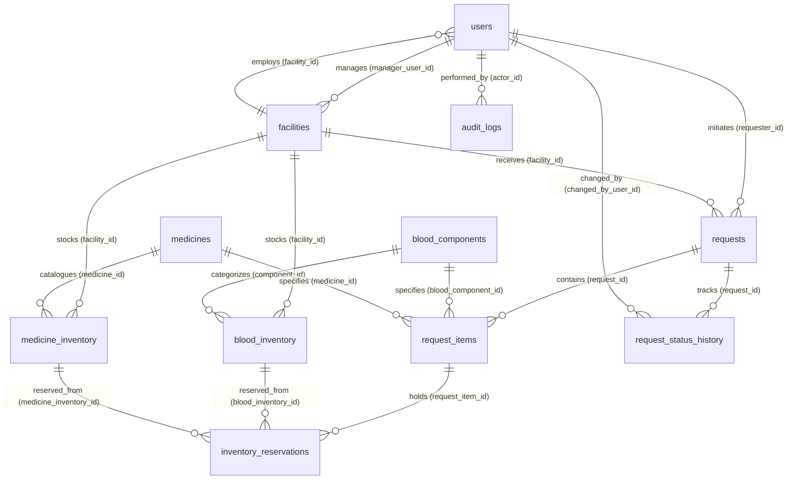

# LifeLink — Database Normalization Analysis (UNF to 3NF)

**Project:** LifeLink Community Blood & Medicine Emergency Logistics Network  
**Academic Module:** Database Engineering (DE) Capstone Milestone  
**Target DBMS:** PostgreSQL 14+  
**Schema Definition:** [`database/schema.sql`](file:///Users/bikash/life%20link/database/schema.sql) | [`server/prisma/schema.prisma`](file:///Users/bikash/life%20link/server/prisma/schema.prisma)  
**ER Diagram Reference:** [`database/ER_DIAGRAM.md`](file:///Users/bikash/life%20link/database/ER_DIAGRAM.md)  
**Author:** Bikash & Engineering Team  
**Date:** October 14, 2026  

---

## Table of Contents
1. [Introduction to Database Normalization](#1-introduction-to-database-normalization)
2. [Core Normalization Forms Explained Simply](#2-core-normalization-forms-explained-simply)
3. [End-to-End Walkthrough: Requisition System from UNF to 3NF](#3-end-to-end-walkthrough-requisition-system-from-unf-to-3nf)
   - [Step 0: Unnormalized Form (UNF) & The Three Anomalies](#step-0-unnormalized-form-unf--the-three-anomalies)
   - [Step 1: First Normal Form (1NF)](#step-1-first-normal-form-1nf)
   - [Step 2: Second Normal Form (2NF)](#step-2-second-normal-form-2nf)
   - [Step 3: Third Normal Form (3NF)](#step-3-third-normal-form-3nf)
4. [Table-by-Table Functional Dependency & Normalization Audit](#4-table-by-table-functional-dependency--normalization-audit)
5. [In-Depth Subsystem Normalization Architecture](#5-in-depth-subsystem-normalization-architecture)
6. [Critical Integrity Analysis & Real-World Normalization Trade-Offs](#6-critical-integrity-analysis--real-world-normalization-trade-offs)
7. [Final Relational Schema Summary](#7-final-relational-schema-summary)
8. [SQL Demonstrations in PostgreSQL](#8-sql-demonstrations-in-postgresql)
9. [Entity-Relationship Diagram (ERD)](#9-entity-relationship-diagram-erd)
10. [Viva Voce & Defense Guide: How to Explain to Your Professor](#10-viva-voce--defense-guide-how-to-explain-to-your-professor)

---

## 1. Introduction to Database Normalization

**Database Normalization** is a systematic, mathematical process of organizing attributes and relations in a relational database to:
1. **Eliminate Redundant Data:** Prevent storing the same piece of information (e.g., a hospital's full street address or blood component shelf life) across multiple records.
2. **Prevent Modification Anomalies:** Ensure that inserting, updating, or deleting a record does not create inconsistent, orphaned, or unintentionally destroyed information.
3. **Enforce Data Integrity:** Guarantee that logical relationships are maintained by foreign keys and domain constraints rather than fragile application code.

### The Formal Concept of Functional Dependency
At the heart of normalization is the **Functional Dependency (FD)**.  
Given a relation $R$, attribute $Y$ is functionally dependent on attribute $X$ (denoted $X \to Y$) if and only if each distinct value of $X$ is associated with exactly one value of $Y$.
* **Example:** `facility_id` $\to$ `{name, address, city, state, contact_phone}`.  
  If we know the facility UUID, there is only one hospital name and city associated with it.

---

## 2. Core Normalization Forms Explained Simply

| Normal Form | Rule in Plain English | Primary Goal | What It Eliminates |
| :--- | :--- | :--- | :--- |
| **UNF** (Unnormalized Form) | A raw spreadsheet or document where single cells hold lists of values, comma-separated items, or repeated column groups. | Initial raw data capture | N/A |
| **1NF** (First Normal Form) | **Atomic attributes** (one scalar value per cell), no repeating groups, unique row identity (Primary Key defined). | Tabular uniformity | Multi-valued columns, duplicate column arrays |
| **2NF** (Second Normal Form) | Must be in 1NF **AND** all non-key attributes must depend on the **entire candidate key**, not just a part of it. | Entity independence | **Partial Functional Dependencies** (only occurs when PK is composite) |
| **3NF** (Third Normal Form) | Must be in 2NF **AND** no non-key attribute can depend on another non-key attribute. | Pure entity modeling | **Transitive Functional Dependencies** ($A \to B$ and $B \to C$) |
| **BCNF** (Boyce-Codd Normal Form) | For every non-trivial functional dependency $X \to Y$, $X$ must be a **superkey**. | Absolute determinant purity | Redundancy in overlapping candidate keys |

> [!TIP]
> **The Classic Bill Kent Golden Rule (1983):**  
> *"Every non-key attribute must provide a fact about the key, the whole key, and nothing but the key, so help me Codd."*
> * **"The key"** $\implies$ 1NF (identifiable single key).
> * **"The whole key"** $\implies$ 2NF (no partial key dependencies).
> * **"Nothing but the key"** $\implies$ 3NF (no transitive dependencies through other non-keys).

---

## 3. End-to-End Walkthrough: Requisition System from UNF to 3NF

> [!IMPORTANT]
> **Academic Disclosure (Requirement 7):**  
> The following unnormalized emergency requisition example is a **hypothetical educational baseline** created specifically to illustrate the decomposition stages (UNF $\to$ 1NF $\to$ 2NF $\to$ 3NF).  
> The actual LifeLink production schema was engineered directly into 3NF relational tables based on formal system domain requirements, rather than migrated from a monolithic legacy spreadsheet.

---

### Step 0: Unnormalized Form (UNF) & The Three Anomalies

Suppose a hospital previously tracked emergency requisition orders on a physical paper ledger or flat Excel worksheet:

#### Hypothetical Table: `unf_emergency_requisitions`
| req_number | req_date | requester_email | requester_name | facility_name | facility_city | items_requested (Blood & Medicine) | urgency |
| :--- | :--- | :--- | :--- | :--- | :--- | :--- | :--- |
| `REQ-2026-001` | 2026-10-14 | `dr.sharma@nph.org` | Dr. Sharma | National Path Hospital | Kathmandu | `[PRBC, B+, 3 units], [Paracetamol 500mg, 100 tabs]` | CRITICAL |
| `REQ-2026-002` | 2026-10-14 | `nurse.rita@kanti.org` | Nurse Rita | Kanti Children's Hosp | Kathmandu | `[Whole Blood, O-, 2 units]` | URGENT |
| `REQ-2026-003` | 2026-10-15 | `dr.sharma@nph.org` | Dr. Sharma | National Path Hospital | Kathmandu | `[Amoxicillin 250mg, 50 caps]` | NORMAL |

#### Why UNF Fails in Healthcare: The Three Destructive Anomalies
1. **Insertion Anomaly:** We cannot register a new medicine in our system (e.g. *Remdesivir*) or a newly onboarded emergency clinic until a doctor creates an actual patient requisition!
2. **Update Anomaly:** If *National Path Hospital* updates its phone number or city, we must search and update dozens of historical requisition rows. If one row is missed, data becomes inconsistent.
3. **Deletion Anomaly:** If `REQ-2026-002` is cancelled and its row deleted, we permanently lose the system's record that Kanti Children's Hospital exists!

---

### Step 1: First Normal Form (1NF)

To achieve **1NF**, we must satisfy two core conditions:
1. **Atomicity:** Every attribute must contain only indivisible (scalar) atomic values.
2. **Elimination of Repeating Groups:** Each cell in `items_requested` must be broken into distinct rows, and an explicit primary key must identify each unique row.

#### Decomposed 1NF Table: `requisitions_1nf`
Composite Primary Key: `{req_number, item_line_number}`

| req_number (PK) | item_line_number (PK) | req_date | requester_email | requester_name | facility_name | facility_city | item_type | item_code | item_name | blood_group | qty_requested | urgency |
| :--- | :--- | :--- | :--- | :--- | :--- | :--- | :--- | :--- | :--- | :--- | :--- | :--- | :--- |
| `REQ-2026-001` | 1 | 2026-10-14 | `dr.sharma@nph.org` | Dr. Sharma | National Path Hospital | Kathmandu | BLOOD | `PRBC` | Packed Red Cells | B+ | 3 | CRITICAL |
| `REQ-2026-001` | 2 | 2026-10-14 | `dr.sharma@nph.org` | Dr. Sharma | National Path Hospital | Kathmandu | MEDICINE | `MED-PARA`| Paracetamol | NULL | 100 | CRITICAL |
| `REQ-2026-002` | 1 | 2026-10-14 | `nurse.rita@kanti.org` | Nurse Rita | Kanti Children's Hosp | Kathmandu | BLOOD | `WB` | Whole Blood | O- | 2 | URGENT |
| `REQ-2026-003` | 1 | 2026-10-15 | `dr.sharma@nph.org` | Dr. Sharma | National Path Hospital | Kathmandu | MEDICINE | `MED-AMOX`| Amoxicillin | NULL | 50 | NORMAL |

#### Candidate Key Evaluation in 1NF
* **Candidate Key:** `{req_number, item_line_number}`.
* **Why 1NF is Insufficient:** Notice the redundancy! For `REQ-2026-001`, `requester_email`, `requester_name`, `facility_name`, and `facility_city` are duplicated across both item lines. This is caused by **Partial Functional Dependencies**.

---

### Step 2: Second Normal Form (2NF)

To achieve **2NF**, a relation must:
1. Be in **1NF**.
2. Have **no Partial Functional Dependencies**: No non-prime attribute may depend on only a proper subset of a composite candidate key. (Note: Any table with a single-attribute candidate key is automatically in 2NF).

#### Analyzing Dependencies in `requisitions_1nf`:
* Composite Primary Key: `{req_number, item_line_number}`
* **Partial Dependency 1:** `{req_number}` $\to$ `{req_date, requester_email, requester_name, facility_name, facility_city, urgency}`  
  *(These depend only on the requisition header, regardless of which line item it is!)*
* **Partial Dependency 2:** `{item_code}` $\to$ `{item_name, item_type}`  
  *(The name of Paracetamol depends on its item code, not on the requisition number!)*
* **Full Functional Dependency:** `{req_number, item_line_number}` $\to$ `{qty_requested, blood_group}`

#### Decomposition into 2NF Tables:

##### Table 1: `requisitions_2nf` (Header Information)
* **Primary Key:** `req_number`
* Columns: `req_number`, `req_date`, `requester_email`, `requester_name`, `facility_name`, `facility_city`, `urgency`
* *Why 2NF?* Primary key is a single column (`req_number`), so partial dependencies cannot exist!

##### Table 2: `catalog_items_2nf` (Product Master)
* **Primary Key:** `item_code`
* Columns: `item_code`, `item_type`, `item_name`
* *Why 2NF?* Single-column primary key.

##### Table 3: `requisition_items_2nf` (Line Items)
* **Primary Key:** `{req_number, item_line_number}`
* **Foreign Keys:** `req_number` $\to$ `requisitions_2nf(req_number)`, `item_code` $\to$ `catalog_items_2nf(item_code)`
* Columns: `req_number`, `item_line_number`, `item_code`, `blood_group`, `qty_requested`
* *Why 2NF?* `qty_requested` depends on both the requisition AND the specific item line.

---

### Step 3: Third Normal Form (3NF)

To achieve **3NF**, a relation must:
1. Be in **2NF**.
2. Have **no Transitive Functional Dependencies**: Non-key attributes must not depend on other non-key attributes ($X \to Y$ and $Y \to Z$ where $Y$ is not a superkey).

#### Identifying Transitive Dependencies in `requisitions_2nf`:
In `requisitions_2nf`:
* `req_number` $\to$ `requester_email` (Primary Key $\to$ Non-Key Attribute)
* `requester_email` $\to$ `requester_name` (Non-Key Attribute $\to$ Non-Key Attribute!)
* `req_number` $\to$ `facility_name` (Primary Key $\to$ Non-Key Attribute)
* `facility_name` $\to$ `{facility_city}` (Non-Key Attribute $\to$ Non-Key Attribute!)

Therefore, `req_number` $\to$ `requester_name` and `req_number` $\to$ `facility_city` are **Transitive Dependencies**! If a doctor changes their name or a hospital updates its city, we still have update anomalies.

#### Final Decomposition into 3NF:
We decompose `requisitions_2nf` and separate biological blood components from chemical pharmaceutical medicines:

```
┌─────────────────┐       ┌─────────────────┐       ┌─────────────────┐
│      users      │       │   facilities    │       │blood_components │
│   (Requesters)  │       │  (Hospitals)    │       │   (Catalog)     │
│ PK: id          │       │ PK: id          │       │ PK: id          │
└────────┬────────┘       └────────┬────────┘       └────────┬────────┘
         │ 1                       │ 1                       │ 1
         │                         │                         │
         │ N                       │ N                       │ N
┌────────┴─────────────────────────┴────────┐       ┌────────┴────────┐
│                 requests                  │       │  request_items  │
│ PK: id                                    │1     N│ PK: id          │
│ FK: requester_id, facility_id             ├───────┤ FK: request_id  │
└───────────────────────────────────────────┘       └─────────────────┘
```

1. **`users` (3NF):** Stores doctor and coordinator credentials.
   * PK: `id` | UK: `email`
   * FDs: `id` $\to$ `email`, `full_name`, `phone`, `role`
2. **`facilities` (3NF):** Stores physical hospital, blood bank, and pharmacy locations.
   * PK: `id`
   * FDs: `id` $\to$ `name`, `facility_type`, `address`, `city`, `state`, `latitude`, `longitude`
3. **`requests` (3NF):** Stores requisition metadata.
   * PK: `id` | UK: `request_number`
   * FDs: `id` $\to$ `requester_id`, `facility_id`, `urgency`, `status`, `expires_at`
   * FKs: `requester_id` $\to$ `users(id)`, `facility_id` $\to$ `facilities(id)`
4. **`request_items` (3NF):** Stores individual line item demands.
   * PK: `id`
   * FKs: `request_id` $\to$ `requests(id)`, `blood_component_id` $\to$ `blood_components(id)`, `medicine_id` $\to$ `medicines(id)`

---

## 4. Table-by-Table Functional Dependency & Normalization Audit

Below is the rigorous mathematical audit of all 11 tables present in the actual LifeLink PostgreSQL schema ([`database/schema.sql`](file:///Users/bikash/life%20link/database/schema.sql)).

### 4.1 Table: `users`
* **Primary Key:** `id` (UUID)
* **Candidate Keys:**
  1. `id`
  2. `email` (Enforced by PostgreSQL `UNIQUE` constraint `users_email_key`)
* **Foreign Keys:** `facility_id` $\to$ `facilities(id)` (`ON DELETE SET NULL`)
* **Functional Dependencies:**
  * `id` $\to$ `email`, `password_hash`, `full_name`, `phone`, `role`, `facility_id`, `created_at`, `updated_at`
  * `email` $\to$ `id`, `password_hash`, `full_name`, `phone`, `role`, `facility_id`, `created_at`, `updated_at`
* **Analysis:**
  * **1NF:** Satisfied. All columns (strings, timestamps, enums) are atomic.
  * **2NF:** Satisfied. Candidate keys (`id`, `email`) are single-column keys; partial key dependencies cannot exist.
  * **3NF:** Satisfied. Every non-prime attribute directly describes the user. No non-key attribute determines another non-key attribute.
  * **BCNF:** Satisfied. All determinants (`id`, `email`) are superkeys.

---

### 4.2 Table: `facilities`
* **Primary Key:** `id` (UUID)
* **Candidate Keys:** `id`
* **Foreign Keys:** `manager_user_id` $\to$ `users(id)` (`ON DELETE SET NULL`)
* **Check Constraints:** `latitude BETWEEN -90 AND 90`, `longitude BETWEEN -180 AND 180`
* **Functional Dependencies:**
  * `id` $\to$ `name`, `facility_type`, `address`, `city`, `state`, `postal_code`, `latitude`, `longitude`, `contact_phone`, `contact_email`, `operating_hours`, `is_verified`, `manager_user_id`, `created_at`, `updated_at`
* **Analysis:**
  * **1NF:** Satisfied. Coordinates are discrete numeric types (`NUMERIC(10,7)`). `operating_hours` is stored as structured PostgreSQL `JSONB` for schema flexibility (see [Trade-offs Section](#6-critical-integrity-analysis--real-world-normalization-trade-offs)).
  * **2NF:** Satisfied. Single-column primary key.
  * **3NF:** Satisfied. In textbook theory, `postal_code` $\to$ `{city, state}` could be flagged as a transitive dependency. However, in Nepal and regional healthcare systems, postal codes are non-standardized or nullable; decomposing `postal_code` into a lookup table would introduce join overhead without functional gain.

---

### 4.3 Table: `blood_components` (Master Catalog)
* **Primary Key:** `id` (UUID)
* **Candidate Keys:**
  1. `id`
  2. `code` (e.g. `'PRBC'`, `'WB'`, `'FFP'`, enforced by `UNIQUE`)
* **Foreign Keys:** None
* **Check Constraints:** `default_shelf_life_days > 0`
* **Functional Dependencies:**
  * `id` $\to$ `code`, `name`, `default_shelf_life_days`, `storage_temp_celsius`, `description`
  * `code` $\to$ `id`, `name`, `default_shelf_life_days`, `storage_temp_celsius`, `description`
* **Analysis:**
  * **1NF, 2NF, 3NF, BCNF:** All satisfied. Pure catalog table with immutable biological component standards.

---

### 4.4 Table: `blood_inventory` (Physical Batches)
* **Primary Key:** `id` (UUID)
* **Candidate Keys:**
  1. `id`
  2. `{facility_id, batch_number}` (Enforced by composite unique constraint `uq_facility_blood_batch`)
* **Foreign Keys:**
  * `facility_id` $\to$ `facilities(id)` (`ON DELETE CASCADE`)
  * `component_id` $\to$ `blood_components(id)` (`ON DELETE RESTRICT`)
* **Check Constraints:**
  * `total_units >= 0`
  * `reserved_units >= 0 AND reserved_units <= total_units`
  * `chk_blood_expiry`: `expiry_date > collection_date`
* **Functional Dependencies:**
  * `id` $\to$ `facility_id`, `component_id`, `blood_group`, `batch_number`, `total_units`, `reserved_units`, `collection_date`, `expiry_date`, `storage_location`, `status`
  * `{facility_id, batch_number}` $\to$ all other attributes.
* **Analysis:**
  * **1NF:** Satisfied. All quantities and dates are scalar types.
  * **2NF:** Satisfied. Although `{facility_id, batch_number}` is a composite candidate key:
    * `component_id`, `blood_group`, `collection_date`, and `expiry_date` do **not** depend on `facility_id` alone.
    * They depend on that specific physical blood bag collected into that batch at that facility. Therefore, no non-key attribute depends on a partial key.
  * **3NF & BCNF:** Satisfied. Both determinants (`id` and `{facility_id, batch_number}`) are superkeys.
  * **Treatment of `available_units` (Rigorous Analysis):**
    * Notice `available_units` is **not stored as a column in the table**.
    * If `available_units` were physically stored, it would introduce the arithmetic functional dependency:
      $$\{total\_units, reserved\_units\} \to available\_units$$
    * In this dependency, the determinant $\{total\_units, reserved\_units\}$ is **NOT a superkey**, and $available\_units$ is **NOT a prime attribute**.
    * Under Codd's formal definition of 3NF (every non-trivial dependency $X \to Y$ must have $X$ as a superkey OR $Y$ as a prime attribute), storing `available_units` would violate 3NF and BCNF, creating an **Update Anomaly** if `total_units` is updated without simultaneously updating `available_units`.
    * LifeLink adheres to relational purity by computing available units dynamically: `(total_units - reserved_units) AS available_units`.

---

### 4.5 Table: `medicines` (Master Pharmaceutical Catalog)
* **Primary Key:** `id` (UUID)
* **Candidate Keys:** `id`
* **Foreign Keys:** None
* **Functional Dependencies:**
  * `id` $\to$ `name`, `generic_name`, `dosage_form`, `strength`, `manufacturer`, `category`, `description`
* **Analysis:**
  * **1NF, 2NF, 3NF:** Satisfied. Decouples drug classification from facility warehouse batch storage.
  * **Candidate Key Note:** In the current PostgreSQL schema, `id` is the sole candidate key. While there is a search index on `(name, generic_name)`, there is no UNIQUE constraint on `{generic_name, dosage_form, strength, manufacturer}`. Adding such a constraint in future iterations would strengthen catalog-level semantic uniqueness.

---

### 4.6 Table: `medicine_inventory` (Physical Drug Batches)
* **Primary Key:** `id` (UUID)
* **Candidate Keys:**
  1. `id`
  2. `{facility_id, medicine_id, batch_number}` (Enforced by composite unique constraint `uq_facility_med_batch`)
* **Foreign Keys:**
  * `facility_id` $\to$ `facilities(id)` (`ON DELETE CASCADE`)
  * `medicine_id` $\to$ `medicines(id)` (`ON DELETE RESTRICT`)
* **Check Constraints:**
  * `total_units >= 0`
  * `reserved_units >= 0 AND reserved_units <= total_units`
* **Functional Dependencies:**
  * `id` $\to$ `facility_id`, `medicine_id`, `batch_number`, `total_units`, `reserved_units`, `expiry_date`, `storage_location`, `status`
  * `{facility_id, medicine_id, batch_number}` $\to$ all other attributes.
* **Analysis:**
  * **1NF, 2NF, 3NF, BCNF:** Satisfied. Both determinants (`id` and the composite natural key) are superkeys.

---

### 4.7 Table: `requests`
* **Primary Key:** `id` (UUID)
* **Candidate Keys:**
  1. `id`
  2. `request_number` (Enforced by `UNIQUE`)
* **Foreign Keys:**
  * `requester_id` $\to$ `users(id)` (`ON DELETE RESTRICT`)
  * `facility_id` $\to$ `facilities(id)` (`ON DELETE RESTRICT`)
* **Functional Dependencies:**
  * `id` $\to$ `request_number`, `requester_id`, `facility_id`, `request_type`, `urgency`, `status`, `clinical_notes`, `expires_at`
  * `request_number` $\to$ all other attributes.
* **Analysis:**
  * **1NF, 2NF, 3NF, BCNF:** Satisfied. Contains strictly requisition-level header details. All items are normalized into `request_items`.

---

### 4.8 Table: `request_items`
* **Primary Key:** `id` (UUID)
* **Candidate Keys:** `id`
* **Foreign Keys:**
  * `request_id` $\to$ `requests(id)` (`ON DELETE CASCADE`)
  * `blood_component_id` $\to$ `blood_components(id)` (`ON DELETE RESTRICT`)
  * `medicine_id` $\to$ `medicines(id)` (`ON DELETE RESTRICT`)
* **Check Constraints:**
  * `quantity_requested > 0`, `quantity_reserved >= 0`, `quantity_fulfilled >= 0`
  * `chk_item_target`:
    ```sql
    CONSTRAINT chk_item_target CHECK (
        (blood_component_id IS NOT NULL AND medicine_id IS NULL) OR
        (blood_component_id IS NULL AND medicine_id IS NOT NULL)
    )
    ```
* **Functional Dependencies:**
  * `id` $\to$ `request_id`, `blood_component_id`, `blood_group`, `medicine_id`, `quantity_requested`, `quantity_reserved`, `quantity_fulfilled`
* **Analysis:**
  * **1NF, 2NF, 3NF:** Satisfied.
  * **Integrity Note:** A request cannot target both blood and medicine in the same line item due to `chk_item_target`. There is no unique constraint on `{request_id, blood_component_id, blood_group}` or `{request_id, medicine_id}`, so duplicate line items are prevented at the application validation layer rather than by database candidate keys.

---

### 4.9 Table: `inventory_reservations`
* **Primary Key:** `id` (UUID)
* **Candidate Keys:** `id`
* **Foreign Keys:**
  * `request_item_id` $\to$ `request_items(id)` (`ON DELETE CASCADE`)
  * `blood_inventory_id` $\to$ `blood_inventory(id)` (`ON DELETE SET NULL`)
  * `medicine_inventory_id` $\to$ `medicine_inventory(id)` (`ON DELETE SET NULL`)
* **Check Constraints:**
  * `reserved_quantity > 0`
  * `chk_res_target`:
    ```sql
    CONSTRAINT chk_res_target CHECK (
        (blood_inventory_id IS NOT NULL AND medicine_inventory_id IS NULL) OR
        (blood_inventory_id IS NULL AND medicine_inventory_id IS NOT NULL)
    )
    ```
* **Functional Dependencies:**
  * `id` $\to$ `request_item_id`, `blood_inventory_id`, `medicine_inventory_id`, `reserved_quantity`, `status`, `expires_at`, `created_at`, `released_at`
* **Analysis:**
  * **1NF, 2NF, 3NF:** Satisfied. Acts as an immutable reservation ledger. Links demand (`request_items`) to supply (`blood_inventory` / `medicine_inventory`).

---

### 4.10 Table: `request_status_history`
* **Primary Key:** `id` (UUID)
* **Candidate Keys:** `id`
* **Foreign Keys:**
  * `request_id` $\to$ `requests(id)` (`ON DELETE CASCADE`)
  * `changed_by_user_id` $\to$ `users(id)` (`ON DELETE SET NULL`)
* **Functional Dependencies:**
  * `id` $\to$ `request_id`, `from_status`, `to_status`, `changed_by_user_id`, `notes`, `created_at`
* **Analysis:**
  * **1NF, 2NF, 3NF:** Satisfied. An append-only state transition ledger.

---

### 4.11 Table: `audit_logs`
* **Primary Key:** `id` (UUID)
* **Candidate Keys:** `id`
* **Foreign Keys:**
  * `actor_id` $\to$ `users(id)` (`ON DELETE SET NULL`)
* **Functional Dependencies:**
  * `id` $\to$ `entity_type`, `entity_id`, `actor_id`, `action`, `details`, `created_at`
* **Analysis:**
  * **1NF, 2NF, 3NF:** Satisfied. Polymorphic activity log recording historical system actions.

---

## 5. In-Depth Subsystem Normalization Architecture

### 5.1 Users and Facilities
* **Cardinality:** Bidirectional 1:N with explicit roles:
  * A facility employs multiple staff members (`users.facility_id` $\to$ `facilities.id`).
  * A facility has at most one designated manager (`facilities.manager_user_id` $\to$ `users.id`).
* **Normalization Achievement:** Hospital contact information is stored exactly once in `facilities`. User profiles are stored in `users`. Updating a hospital's emergency hotline does not touch any user records.

### 5.2 Catalog vs. Inventory Separation (Blood and Medicines)
A major database engineering design pattern implemented in LifeLink is the **Catalog-Inventory Decoupling Pattern**:
* **Catalog (`blood_components`, `medicines`):** Defines **what** the resource is (chemical formula, shelf life, dosage, storage temperature). Immutable across batches.
* **Inventory (`blood_inventory`, `medicine_inventory`):** Defines **where** and **how much** of the resource is physically stored (warehouse shelf, batch number, units, collection date, expiry date, status).
* **Benefit:** If standard storage temperature for *Fresh Frozen Plasma* is updated, exactly **one** row in `blood_components` is modified, avoiding updates to thousands of inventory bags.

---

## 6. Critical Integrity Analysis & Real-World Normalization Trade-Offs

Academic honesty requires acknowledging where real-world production engineering decisions intersect with theoretical normalization purity.

### 6.1 Nullable Foreign Keys in `request_items` and `inventory_reservations`
* **Observation:** In `request_items`, columns `blood_component_id`, `blood_group`, and `medicine_id` are nullable. Similarly, in `inventory_reservations`, `blood_inventory_id` and `medicine_inventory_id` are nullable.
* **Why this occurs (Polymorphism):** Requisitions in LifeLink handle both biological blood products and pharmaceutical supplies.
* **Academic Alternatives Evaluated:**
  1. *Class Table Inheritance (Pure 3NF Subtyping):* Create two tables: `blood_request_items` and `medicine_request_items`.
     * *Trade-off:* Requires complex `UNION ALL` queries on every emergency dispatch dashboard.
  2. *Single Table with Mutual Exclusivity Check (LifeLink Implementation):*
     ```sql
     CONSTRAINT chk_item_target CHECK (
         (blood_component_id IS NOT NULL AND medicine_id IS NULL) OR
         (blood_component_id IS NULL AND medicine_id IS NOT NULL)
     )
     ```
     * *Result:* Preserves 3NF without join penalties, while PostgreSQL constraint enforcement prevents orphaned or ambiguous targets.

### 6.2 JSONB Storage in `facilities.operating_hours`
* **Observation:** `facilities.operating_hours` uses PostgreSQL `JSONB` rather than a normalized `facility_operating_hours(facility_id, day_of_week, open_time, close_time)` table.
* **Justification:** Operating hours are retrieved and rendered atomically as a display card in the client UI. Relational querying of individual opening minutes is not required by system analytics. Storing as JSONB avoids a 7-row relational join per facility while preserving rapid indexing via GIN indexes if needed.

### 6.3 Composite Uniqueness Constraints as Candidate Keys
* `blood_inventory`: `CONSTRAINT uq_facility_blood_batch UNIQUE (facility_id, batch_number)`
* `medicine_inventory`: `CONSTRAINT uq_facility_med_batch UNIQUE (facility_id, medicine_id, batch_number)`
* **Theoretical Significance:** These unique constraints serve as **Alternate Candidate Keys**. Because every attribute functionally determined by these composite keys is either part of another candidate key or a non-prime attribute with no partial dependencies, the tables satisfy **BCNF (Boyce-Codd Normal Form)**.

### 6.4 Derived vs. Stored Attributes: The `available_units` Clarification
* In naive database designs, developers often add an `available_units` column to inventory tables.
* As established in Section 4.4, $available\_units$ is an arithmetic function of two non-prime attributes:
  $$available\_units = total\_units - reserved\_units$$
* Storing $available\_units$ in the base table would create a non-trivial functional dependency between non-prime attributes:
  $$\{total\_units, reserved\_units\} \to available\_units$$
* Because the determinant $\{total\_units, reserved\_units\}$ is not a candidate key and $available\_units$ is not a prime attribute, storing it violates 3NF and BCNF, opening the door to update anomalies (e.g. reserving stock without reducing available units). Calculating it on the fly maintains full relational consistency.

---

## 7. Final Relational Schema Summary

| Table Name | Primary Key | Alternate Candidate Keys | Foreign Keys | Normal Form |
| :--- | :--- | :--- | :--- | :--- |
| **`users`** | `id` | `email` | `facility_id` $\to$ `facilities(id)` (`SET NULL`) | **3NF / BCNF** |
| **`facilities`** | `id` | None | `manager_user_id` $\to$ `users(id)` (`SET NULL`) | **3NF** |
| **`blood_components`** | `id` | `code` | None | **3NF / BCNF** |
| **`blood_inventory`** | `id` | `{facility_id, batch_number}` | `facility_id` $\to$ `facilities(id)` (`CASCADE`)<br>`component_id` $\to$ `blood_components(id)` (`RESTRICT`) | **3NF / BCNF** |
| **`medicines`** | `id` | None | None | **3NF** |
| **`medicine_inventory`**| `id` | `{facility_id, medicine_id, batch_number}` | `facility_id` $\to$ `facilities(id)` (`CASCADE`)<br>`medicine_id` $\to$ `medicines(id)` (`RESTRICT`) | **3NF / BCNF** |
| **`requests`** | `id` | `request_number` | `requester_id` $\to$ `users(id)` (`RESTRICT`)<br>`facility_id` $\to$ `facilities(id)` (`RESTRICT`) | **3NF / BCNF** |
| **`request_items`** | `id` | None | `request_id` $\to$ `requests(id)` (`CASCADE`)<br>`blood_component_id` $\to$ `blood_components(id)` (`RESTRICT`)<br>`medicine_id` $\to$ `medicines(id)` (`RESTRICT`) | **3NF** |
| **`inventory_reservations`** | `id` | None | `request_item_id` $\to$ `request_items(id)` (`CASCADE`)<br>`blood_inventory_id` $\to$ `blood_inventory(id)` (`SET NULL`)<br>`medicine_inventory_id` $\to$ `medicine_inventory(id)` (`SET NULL`) | **3NF** |
| **`request_status_history`** | `id` | None | `request_id` $\to$ `requests(id)` (`CASCADE`)<br>`changed_by_user_id` $\to$ `users(id)` (`SET NULL`) | **3NF** |
| **`audit_logs`** | `id` | None | `actor_id` $\to$ `users(id)` (`SET NULL`) | **3NF** |

---

## 8. SQL Demonstrations in PostgreSQL

The following verified PostgreSQL queries demonstrate 3NF integrity and constraint enforcement:

### 8.1 Verifying No Partial Dependencies via Relational Join
To prove that catalog attributes (`name`, `storage_temp_celsius`) are not duplicated in inventory:
```sql
SELECT 
    bi.batch_number,
    bi.blood_group,
    bi.total_units - bi.reserved_units AS available_units,
    bc.name AS component_name,
    bc.storage_temp_celsius,
    f.name AS facility_name
FROM blood_inventory bi
JOIN blood_components bc ON bi.component_id = bc.id
JOIN facilities f ON bi.facility_id = f.id
WHERE bi.status = 'AVAILABLE';
```

### 8.2 Testing Candidate Key Composite Uniqueness (BCNF Proof)
Attempting to insert a duplicate batch at the same facility triggers PostgreSQL constraint `uq_facility_blood_batch`:
```sql
-- This query will fail with: ERROR: duplicate key value violates unique constraint "uq_facility_blood_batch"
INSERT INTO blood_inventory (
    facility_id, component_id, blood_group, batch_number, total_units, collection_date, expiry_date
) VALUES (
    'fac00001-0000-0000-0000-000000000001',
    'bc000001-0000-0000-0000-000000000001',
    'A+',
    'KATH-WB-2026-001', -- Already exists in seed.sql
    10,
    CURRENT_DATE,
    CURRENT_DATE + INTERVAL '35 days'
);
```

### 8.3 Testing Mutual Exclusivity Check Constraint in `request_items`
Attempting to violate the mutual exclusivity check:
```sql
-- This query will fail with: ERROR: new row for relation "request_items" violates check constraint "chk_item_target"
INSERT INTO request_items (
    request_id, blood_component_id, medicine_id, quantity_requested
) VALUES (
    'req00001-0000-0000-0000-000000000001',
    'bc000001-0000-0000-0000-000000000001', -- Both blood AND medicine specified!
    'med00001-0000-0000-0000-000000000001',
    5
);
```

---

## 9. Entity-Relationship Diagram (ERD)

Below is the normalized relational diagram depicting all 11 tables and 17 foreign key relationships matching [`database/ER_DIAGRAM.md`](file:///Users/bikash/life%20link/database/ER_DIAGRAM.md).



---

## 10. Viva Voce & Defense Guide: How to Explain to Your Professor

When defending this database normalization architecture before your external examiner or faculty professor, use this structured response framework:

### Question 1: "Explain normalization in simple words. Why did your project need it?"
> **Answer:**  
> *"Normalization is the mathematical process of decomposing tables to eliminate data redundancy and modification anomalies. In our LifeLink platform, we handle life-critical blood and medicine inventories. If we stored hospital details or blood shelf-life inside individual batch rows (UNF or 1NF), updating a hospital phone number could leave conflicting records, and deleting an empty batch might delete our only record of a medicine. By taking our design to 3NF, every fact is stored in exactly one place."*

### Question 2: "What is the difference between 2NF and 3NF?"
> **Answer:**  
> *"2NF addresses **partial functional dependencies**; it requires that all non-key attributes depend on the **entire** candidate key. This is only an issue when tables have composite primary keys.  
> 3NF addresses **transitive functional dependencies**; it requires that no non-key attribute depends on another non-key attribute ($A \to B \to C$). As Bill Kent famously stated: every non-key attribute must tell a fact about 'the key (1NF), the whole key (2NF), and nothing but the key (3NF)'."*

### Question 3: "Why did you separate `blood_components` from `blood_inventory`?"
> **Answer:**  
> *"That demonstrates catalog-versus-inventory decomposition in 3NF. `blood_components` represents medical standards that never change between bags—such as Packed Red Blood Cells requiring storage between 2°C and 6°C with a 42-day default shelf life. `blood_inventory` represents physical instances collected at a specific hospital on a specific date. If we merged them, we would duplicate the storage temperature thousands of times across every blood unit."*

### Question 4: "Why do you have nullable foreign keys in `request_items` and `inventory_reservations`? Doesn't that violate normalization?"
> **Answer:**  
> *"No, sir/ma'am. Nullable foreign keys do not violate 3NF because all non-key attributes still functionally depend strictly on the table's primary key (`id`). What it represents is a **polymorphic exclusive arc** between blood and medicines. Instead of splitting request items into two separate tables (`blood_request_items` and `medicine_request_items`) which would force expensive `UNION ALL` queries on emergency dashboards, we unified them into `request_items` and enforced relational integrity using a PostgreSQL `CHECK` constraint (`chk_item_target`) that mathematically guarantees exactly one product pointer is populated per row."*

### Question 5: "Is your schema in BCNF?"
> **Answer:**  
> *"Yes, our core tables satisfy Boyce-Codd Normal Form (BCNF). In BCNF, for every functional dependency $X \to Y$, determinant $X$ must be a superkey. In `blood_inventory`, we have two candidate keys: the synthetic surrogate key `id`, and the natural composite key `{facility_id, batch_number}` enforced by a unique constraint. Because both determinants are valid candidate keys, no non-superkey determinant exists, satisfying BCNF."*

### Question 6: "Why didn't you store `available_units` as a column in `blood_inventory`?"
> **Answer:**  
> *"Because `available_units` is an algebraically derived attribute: $available\_units = total\_units - reserved\_units$. Storing it would establish a functional dependency between non-prime attributes: $\{total\_units, reserved\_units\} \to available\_units$. Since $\{total\_units, reserved\_units\}$ is not a superkey and $available\_units$ is not a prime attribute, storing it violates 3NF and BCNF, introducing an update anomaly where stock reservations could become inconsistent with available units. In 3NF, derived metrics are computed dynamically on query."*
