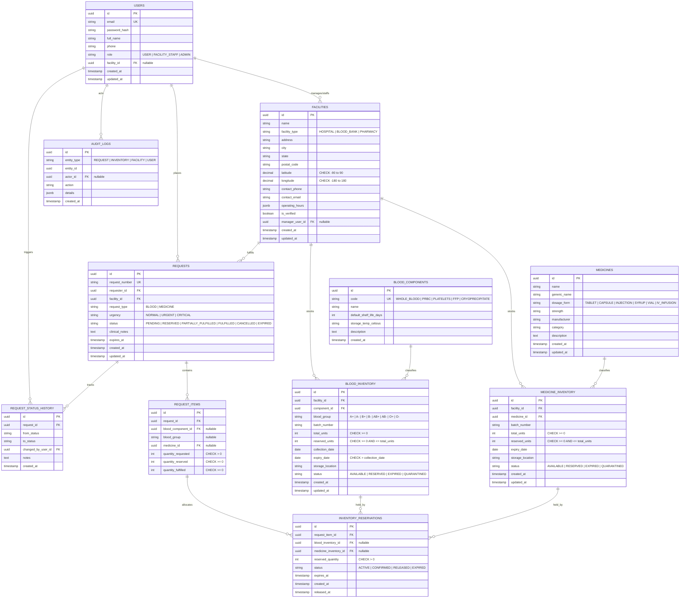

# LifeLink — Entity-Relationship Architecture (3NF Relational Model)

> **Status:** APPROVED & FINALIZED (Conforming to Third Normal Form)  
> **Course Track:** Database Engineering (DE-01 & DE-02)  
> **Target Schema:** PostgreSQL 14+ / Prisma ORM

---

## 1. Entity-Relationship Overview (Mermaid)

---

## 2. Normalization & Design Justifications (3NF)

1. **Medicines Master Catalog vs. Inventory:**
   - In 1NF/2NF, medicine attributes (name, generic name, dosage form, strength) were repeatedly stored on every batch in `medicine_inventory`.
   - Splitting into `medicines` and `medicine_inventory` eliminates transitive dependencies ($X \to Y \to Z$), achieving 3NF.
2. **Blood Components Catalog:**
   - Defines clinical constants ($shelf\_life$, storage temperature) independently of stock batches.
3. **Explicit Reservation Ledger:**
   - `inventory_reservations` models reservation holds explicitly, preserving ACID guarantees and avoiding ghost allocations.
4. **Scoper Uniqueness:**
   - Composite unique key `(facility_id, batch_number)` reflects real-world clinical supply chains where batch identifiers are assigned regionally.
