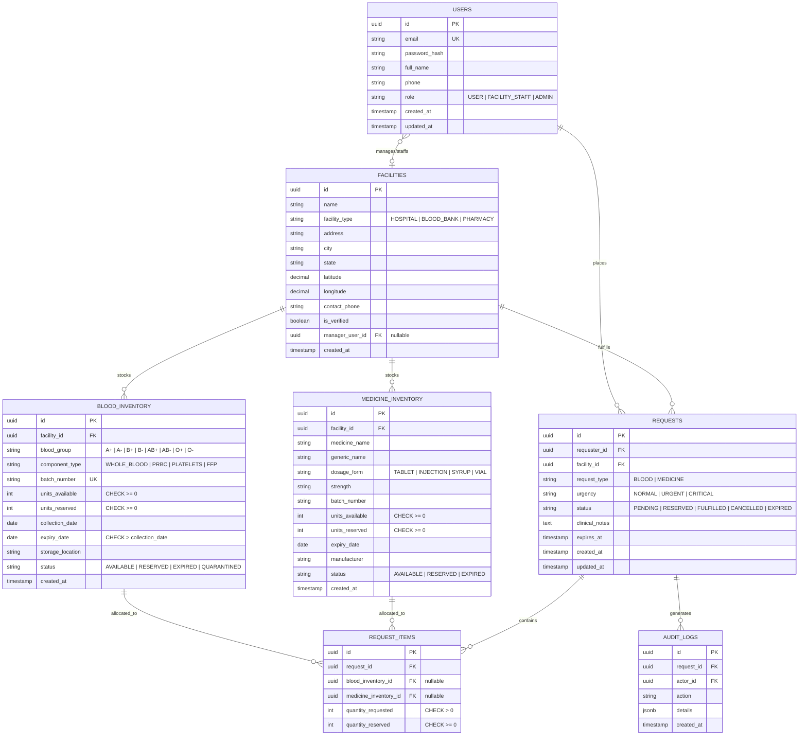

# LifeLink — Preliminary Entity-Relationship Diagram (DRAFT)

> **NOTICE: DRAFT DESIGN — SUBJECT TO DATA MODEL REVIEW**  
> *This document contains the proposed initial relational model for LifeLink. It serves as a discussion draft for peer and instructor review before migrations and database schemas are finalized.*

---

## 1. Entity-Relationship Overview (Mermaid)

---

## 2. Entity Descriptions & Keys

### `USERS`
- **Primary Key:** `id` (UUIDv4)
- **Alternate Key:** `email` (Unique)
- **Purpose:** Central user registry supporting role-based access control.

### `FACILITIES`
- **Primary Key:** `id` (UUIDv4)
- **Foreign Key:** `manager_user_id` $\to$ `USERS(id)`
- **Purpose:** Stores verified institutions (Hospitals, Blood Banks, Pharmacies) with geographic coordinates for distance calculation.

### `BLOOD_INVENTORY`
- **Primary Key:** `id` (UUIDv4)
- **Foreign Key:** `facility_id` $\to$ `FACILITIES(id)`
- **Integrity Constraints:**
  - `CHECK (units_available >= 0)`
  - `CHECK (units_reserved >= 0)`
  - `CHECK (units_reserved <= units_available)`
  - `CHECK (expiry_date > collection_date)`

### `MEDICINE_INVENTORY`
- **Primary Key:** `id` (UUIDv4)
- **Foreign Key:** `facility_id` $\to$ `FACILITIES(id)`
- **Integrity Constraints:**
  - `CHECK (units_available >= 0)`
  - `CHECK (units_reserved >= 0)`

### `REQUESTS` & `REQUEST_ITEMS`
- **Primary Key:** `id` (UUIDv4)
- **Foreign Keys:** `requester_id` $\to$ `USERS(id)`, `facility_id` $\to$ `FACILITIES(id)`
- **Normalization (3NF):** Request items are factored into `REQUEST_ITEMS` to support multi-item or batch allocations without repeating groups.

### `AUDIT_LOGS`
- **Primary Key:** `id` (UUIDv4)
- **Purpose:** Immutable log of state transitions (e.g., status changes, stock reservations) for auditability.

---

## 3. Medical Safety & Privacy Principles

1. **No Real Patient PII:** Requisitions store synthetic identifiers and clinical notes without real-world identifying data.
2. **Expired Inventory Masking:** Inventory queries MUST enforce `WHERE expiry_date > CURRENT_DATE AND status = 'AVAILABLE'` to guarantee expired units are never reported as available.
3. **Draft Review Required:** No database tables or Prisma migrations will be generated until this draft model is formally reviewed.
